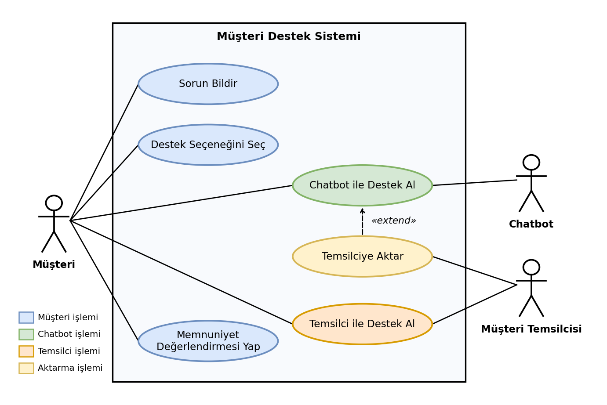
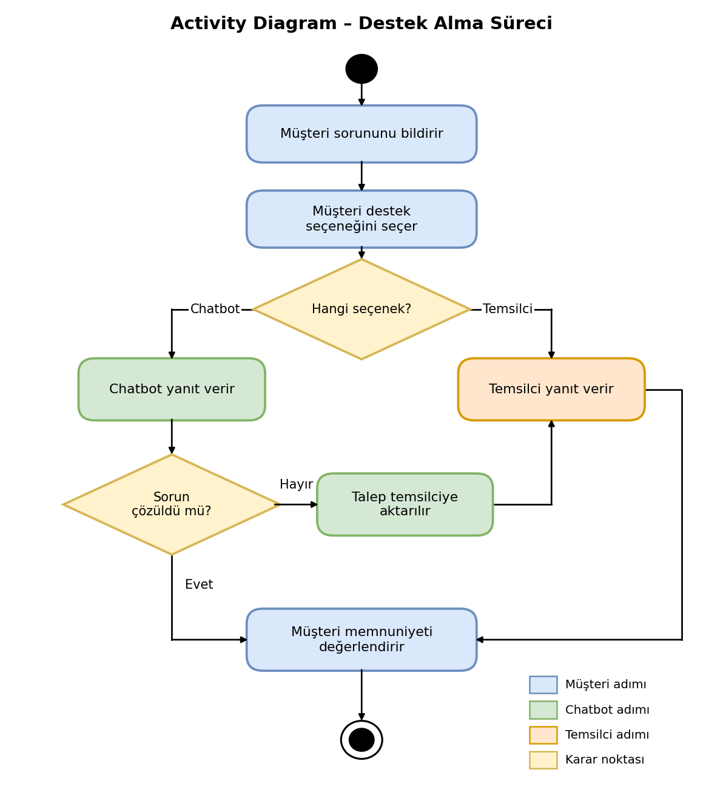
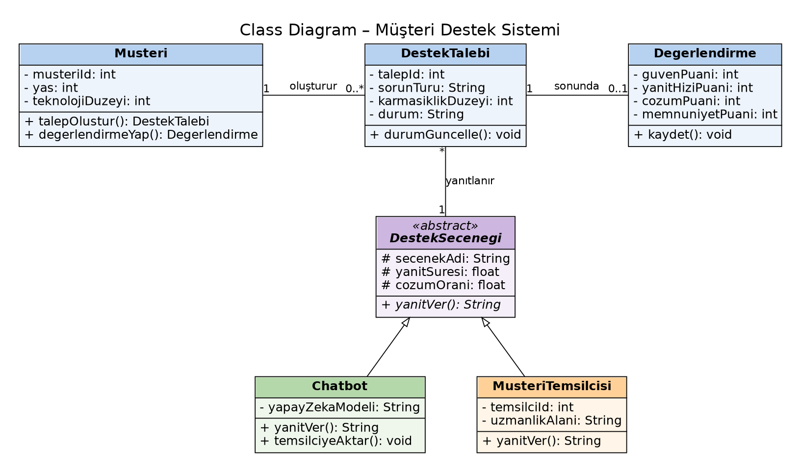

# Müşteri Hizmetlerinde Müşteri Temsilcisi ve Yapay Zekâ Destekli Chatbot Tercihini Etkileyen Faktörler

## Araştırma Konusu

İnsanların bir sorun yaşadıklarında **müşteri temsilcisi** veya **yapay zekâ destekli chatbotlardan** destek alma tercihlerini etkileyen faktörleri incelemek.

## Problem

Şirketler müşteri hizmetlerinde yapay zekâ destekli chatbotları giderek daha fazla kullanmaktadır. Ancak kullanıcıların hangi durumlarda müşteri temsilcisini, hangi durumlarda chatbotu tercih ettiği yeterince bilinmemektedir. Kargo takibi ve şifre sıfırlama gibi basit işlemlerde mi, yoksa şikâyet, iade ve fatura itirazı gibi daha zor durumlarda mı hangi destek yönteminin tercih edildiği, araştırılması gereken temel bir sorudur.

## Amaç

Yanıt hızı, güven ve sorun çözme gibi faktörlerin kullanıcı tercihini nasıl etkilediğini incelemek ve elde edilen sonuçlara dayanarak şirketler için uygulanabilir bir **hibrit hizmet modeli** önermektir. Bu modelde basit sorunlar chatbot tarafından çözülür, karmaşık ya da duygusal açıdan hassas sorunlar ise müşteri temsilcisine yönlendirilir.

## Araştırma Soruları

**Ana soru:** Kullanıcılar bir sorun yaşadıklarında müşteri temsilcisini veya yapay zekâ destekli chatbotu tercih ederken hangi faktörlerden etkilenmektedir?

| Alt soru | İçerik | İlgili hipotezler |
|---|---|---|
| AS1 | Sorunun karmaşıklığı ve kullanıcının duygu durumu tercihi nasıl etkiliyor? | H1, H2 |
| AS2 | Yanıt hızı, güven ve sorun çözme beklentisi tercihte ne kadar etkili? | H3, H4 |
| AS3 | Yaş ve teknoloji kullanım düzeyi tercihi etkiliyor mu? | H5, H6 |

## Hipotezler

| No | Hipotez | Nasıl incelenecek? |
|---|---|---|
| H1 | Kullanıcılar basit ve rutin sorunlarda chatbotları daha fazla tercih eder. | Literatür |
| H2 | Kullanıcılar karmaşık veya duygusal açıdan hassas sorunlarda müşteri temsilcisini daha fazla tercih eder. | Literatür |
| H3 | Chatbota duyulan güven arttıkça chatbotu tercih etme eğilimi artar. | Veri setleri |
| H4 | Chatbotun yanıt hızını ve sorun çözme kapasitesini yüksek değerlendiren kullanıcılar chatbotu daha çok tercih eder. | Literatür |
| H5 | Kullanıcının yaşı arttıkça chatbotu tercih etme eğilimi azalır. | Veri setleri |
| H6 | Teknoloji kullanım düzeyi yükseldikçe chatbotu tercih etme eğilimi artar. | Veri setleri |

## Literatür Özeti

Yapılan çalışmalar genel olarak şunu göstermektedir:

- Chatbotlar sipariş sorgulama, iade ve değişim gibi **rutin işlerde** verimli bulunmaktadır (Bahar, 2025; Decelis ve Castillo, 2025).
- Chatbota duyulan **güven**, müşteri memnuniyetini etkileyen en güçlü etkenlerden biridir (Ventura ve Karabaşak, 2024).
- Kullanıcılar **karmaşık ve duygusal** konularda insan temsilciyi tercih etmektedir (Klein, 2025; Aweda-Akinuliola ve Odunewu, 2026).
- Hızlı yanıt, doğruluk ve gerektiğinde insana yönlendirme chatbottan beklenen önemli özelliklerdir (Altın, 2025).
- Aweda-Akinuliola ve Odunewu (2026), chatbotu karmaşık durumlarda insan temsilciye yönlendiren **hibrit bir model** önermektedir. Bu projedeki model de bu fikre dayanmaktadır.

## Veri Kaynakları

Çalışmada açık erişimli veri setleri, resmî istatistikler ve yayımlanmış araştırma sonuçları kullanılacaktır.

| Kaynak | Lisans | İçerik | Bağlantı |
|---|---|---|---|
| Yatawara vd. (2025), Mendeley Data | CC BY 4.0 | Sri Lanka e-ticaret örneklemi; chatbot özellikleri, güven, memnuniyet, yaş ve alışveriş sıklığı | [Veri seti](https://data.mendeley.com/datasets/9fz3rrm3xj/2) |
| Ramadhani vd. (2025), Zenodo | CC BY 4.0 | İnsan katkısının açıklanmasının müşteri güveni ve iletişim tarzına etkisi | [Veri seti](https://zenodo.org/records/15745343) |
| Aweda-Akinuliola ve Odunewu (2026), Zenodo | Bağlantı sayfasındaki koşullar | Chatbot ve insan temsilci tercihini karşılaştıran çalışma (yalnızca yayımlanmış sonuçlar) | [Makale](https://zenodo.org/records/18816915) |
| TÜİK, Yapay Zekâ İstatistikleri, 2026 | TÜİK kullanım koşulları | Yaş ve eğitim düzeyine göre yapay zekâ kullanım oranları | [Bülten](https://veriportali.tuik.gov.tr/tr/press/62066) |

## Yöntem ve Analiz Planı

Araştırmada **ikincil veri analizi** ve **literatür taraması** yöntemi kullanılacaktır. Analizler Excel ve Python ortamında yapılacaktır.

1. Yatawara vd. (2025) ve Ramadhani vd. (2025) veri setlerinde frekans, yüzde, ortalama, standart sapma ve dağılım gibi betimsel istatistikler hesaplanacaktır. Güven, memnuniyet ve etkileşim ortalamaları yaş gruplarına ve çevrimiçi alışveriş sıklığına göre karşılaştırılacak, sonuçlar tablo ve grafiklerle sunulacaktır (H3, H5, H6).
2. H1, H2 ve H4 literatüre dayanarak ele alınacaktır. Aweda-Akinuliola ve Odunewu (2026), Klein (2025), Decelis ve Castillo (2025) ve Altın (2025) çalışmalarının bulguları karşılaştırılacaktır.
3. TÜİK verileri, yaş ve eğitim düzeyine göre yapay zekâ kullanım oranlarını göstermek için kullanılacaktır.
4. Son aşamada bulgulara dayanarak, sorun türüne göre kullanıcıyı chatbota ya da müşteri temsilcisine yönlendiren bir hibrit hizmet modeli önerilecektir.

## UML Diyagramları (Ödev 3)

Bu bölümde, önermeyi planladığım hibrit hizmet modelinin basit bir taslağını UML diyagramlarıyla gösterdim. Modelde müşteri, chatbot veya müşteri temsilcisi seçeneklerinden birini seçerek destek alıyor. Chatbot sorunu çözemezse talep müşteri temsilcisine aktarılıyor. Diyagramlar [`diyagramlar/`](diyagramlar/) klasöründedir.

| Diyagram | Dosya | Ne gösteriyor? |
|---|---|---|
| Use Case | [`01_use_case_diagram.png`](diyagramlar/01_use_case_diagram.png) | Sistemi kimlerin kullandığını ve neler yapabildiklerini |
| Activity | [`02_activity_diagram.png`](diyagramlar/02_activity_diagram.png) | Müşterinin destek alma sürecini, karar noktalarıyla birlikte |
| Class | [`03_class_diagram.png`](diyagramlar/03_class_diagram.png) | Sistemin sınıflarını, özelliklerini, metotlarını ve ilişkilerini |

### Use Case Diagram



Üç aktör vardır: **Müşteri**, **Chatbot** ve **Müşteri Temsilcisi**. Müşteri sorununu bildirir, destek seçeneğini seçer, chatbot ya da temsilciden destek alır ve memnuniyetini değerlendirir. Chatbot sorunu çözemezse "Temsilciye Aktar" işlemi devreye girer (`extend`) ve aktarılan talebi müşteri temsilcisi alır.

### Activity Diagram



Süreç, müşterinin sorununu bildirmesiyle başlar ve destek seçeneğini seçmesiyle devam eder. Chatbot seçilirse ve sorun çözülürse süreç memnuniyet değerlendirmesiyle biter. Sorun çözülmezse talep müşteri temsilcisine aktarılır. Temsilci seçilirse talep doğrudan temsilci tarafından yanıtlanır.

### Class Diagram



`DestekSecenegi` soyut sınıfından `Chatbot` ve `MusteriTemsilcisi` sınıfları türer. `Musteri` bir `DestekTalebi` oluşturur, talep bir destek seçeneği tarafından yanıtlanır ve sonunda bir `Degerlendirme` yapılır. Sınıflardaki özellikler, araştırmadaki değişkenlere göre seçilmiştir:

- `sorunTuru`, `karmasiklikDuzeyi`: sorunun karmaşıklığı (H1, H2)
- `guvenPuani`, `yanitHiziPuani`, `cozumPuani`: güven, yanıt hızı ve sorun çözme (H3, H4)
- `yas`, `teknolojiDuzeyi`: kullanıcı özellikleri (H5, H6)


## Veri Analizi (Google Colab)

Not defteri: [`361526102_Aysemanav_colab_musteri_hizmetleri.ipynb`](361526102_Aysemanav_colab_musteri_hizmetleri.ipynb)

### Görev dağılımı

**Grup:** Bireysel proje. Veri kaynaklarını belirleme, verileri hazırlama, Python ile toplam/ortalama hesaplama, grafik hazırlama ve yorumlama çalışmalarının tamamı bana aittir.

### Veri kaynağı, lisans ve erişim

| Veri kaynağı | Dosya | Lisans | Bağlantı / DOI | Katılımcı |
|---|---|---|---|---|
| Yatawara vd. (2025), Mendeley Data, Version 2 | `AI Chatbot Affordances and Purchase Intention Dataset.csv` | CC BY 4.0 | https://data.mendeley.com/datasets/9fz3rrm3xj/2 • DOI: 10.17632/9fz3rrm3xj.2 | 385 |
| Ramadhani vd. (2025), Zenodo, Version v1 | `HID Impact - Suppl Material - Questionnaire Result Data.csv` | CC BY 4.0 | https://zenodo.org/records/15745343 • DOI: 10.5281/zenodo.15745343 | 297 |
| TÜİK (2026), Yapay Zekâ İstatistikleri | Yayımlanmış resmî istatistik grafiği (yalnızca yüzde değerleri; dosya paylaşılmadı) | TÜİK kullanım koşulları, kaynak gösterilerek | https://veriportali.tuik.gov.tr/tr/press/62066 | - |

- **Erişim tarihi:** 07.11.2026
- **Yapılan değişiklik:** Mendeley ve Zenodo'daki orijinal Excel dosyaları Pandas ile CSV'ye dönüştürüldü. Satır, sütun ve değerlerde başka hiçbir değişiklik yapılmadı.
- **Lisans metni:** https://creativecommons.org/licenses/by/4.0/
- **Ölçü birimi:** Anket soruları 1–5 Likert puanıdır; TÜİK değerleri yüzdedir (%).
- **Veri türü:** Gerçek, açık erişimli ikincil veri. Temsili veri kullanılmamıştır.
- Ramadhani veri setinde yalnızca müşteri temsilcisiyle ilgili T1–T7 soruları analiz edildi.

### Klasör yapısı

```
├── README.md
├── 361526102_Aysemanav_colab_musteri_hizmetleri.ipynb   # Colab not defteri
├── veri/                                                # İki anket veri seti (CSV)
└── diyagramlar/                                         # UML diyagramları (Ödev 3)
```

### Nasıl çalıştırılır?

1. Google Colab'da `Dosya → Not defterini yükle` ile `.ipynb` dosyasını açın.
2. `Çalışma zamanı → Tümünü çalıştır` deyin.
3. İstendiğinde `veri/` klasöründeki iki CSV dosyasını yükleyin.

### Sonuç özeti

- **Katılımcılar:** Yatawara'da %60.5 erkek, en kalabalık grup 18–29 yaş (%57.4); Ramadhani'de %58.2 kadın, en kalabalık grup 13–28 yaş (%56.9).
- **Chatbot deneyimi (Yatawara vd.):** Ortalama puanlar 3.73 ile 3.94 arasında. En yüksek ortalama satın alma niyetinde (3.94), en düşük chatbotla etkileşime bağlılıkta (3.73); chatbota güven ortalaması 3.79.
- **Müşteri temsilcisi (Ramadhani vd., T1–T7):** Yedi sorunun ortalaması 4.03 ile 4.18 arasında, hepsi birlikte 4.09. En yüksek puan "gerekli becerilere sahip olma" (4.18), en düşük "güvenilir olma" (4.03).
- **TÜİK:** Türkiye'de üretken yapay zekâ kullanım oranı genelde %37.6; 16–24 yaşta %64.9, 65–74 yaşta %5.1. Yaş büyüdükçe oran düşüyor.
- Bu aşamada yaş gruplarına göre karşılaştırma yapılmadı; yalnızca betimsel özet ve dağılım verildi. Grafik açıklamaları ve akademik yorum not defterinde (D ve E bölümleri) yer alıyor.

### Sınırlılıklar

İki veri setinde de "müşteri temsilcisi mi, chatbot mu tercih edersiniz?" sorusu olmadığı için tercih oranı hesaplanamadı. Chatbot ve temsilci ortalamaları farklı kişilere ve farklı sorulara ait olduğundan birbiriyle karşılaştırılmadı. Veriler Türkiye'de toplanmadı ve ortalamalar neden-sonuç ilişkisi kanıtlamaz.


## Durum

Proje önerisi dosyası, UML diyagramları (Use Case, Activity ve Class) , veri analizi (Colab not defteri ve veri dosyaları) bu depoya yüklenmiştir.

